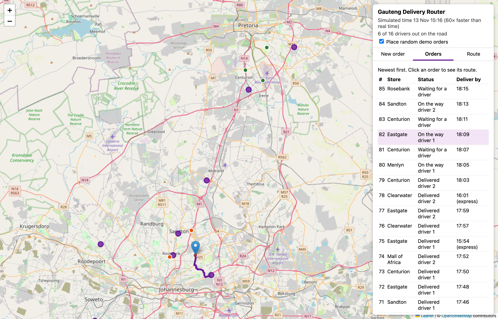

# Gauteng Delivery Router

> **Starting the app: two ways**
>
> - `./mvnw spring-boot:run` starts with random demo orders **stopped**. Only the orders you
>   place appear, which makes your own quotes and orders easy to follow. Tick **Place random demo
>   orders** at the top of the map page to start them, and untick it to stop them, while the app
>   runs.
> - `./mvnw spring-boot:run -Dspring-boot.run.arguments=--gautenglogistics.generator.enabled=true`
>   starts with random demo orders **already running** (the box is ticked when the page opens).
>   Use it when you want the map busy straight away, for example before showing the demo.
>
> Either way, open http://localhost:8080. The first time, import the map first (see
> [Running it](#running-it)).

A Spring Boot backend for same-day delivery across Johannesburg and Pretoria, routing over
**real OpenStreetMap roads** (450,000 intersections, 1.1 million road pieces).

When an online order comes in, it:

1. **picks the store** that has everything in stock and can reach the customer fastest by road,
2. **takes the stock** safely, even when many orders arrive at once,
3. **dispatches drivers most-urgent-first**, with a limited number of drivers per store, and
4. **shows every driver moving live** on a map, along the real road shape.

Everything can be done from the map page: get a quote, place an order, follow it in the orders
list, check a store's stock, plan a route, and start or stop random demo orders.



## Highlights

- **A\* and Dijkstra on a real road graph.** The map is a directed graph (one-way streets
  included) weighted by travel time. Point-to-point routes use A\* with a straight-line guess at
  the top road speed, which finds exactly the same routes as Dijkstra while looking at far fewer
  intersections:

  | Route | Dijkstra | A\* | |
  |---|---:|---:|---|
  | Soweto → Menlyn, 75.8 km | 314,490 | 111,369 | 2.8× fewer |
  | Clearwater → Eastgate, 28.0 km | 133,284 | 52,467 | 2.5× fewer |
  | Mall of Africa → Centurion, 21.9 km | 56,697 | 8,618 | 6.6× fewer |
  | Sandton → Rosebank, 5.7 km | 10,553 | 3,538 | 3.0× fewer |

  `GET /routes` for Soweto → Menlyn dropped from about 0.25 s to 0.10 s.
- **Store choice with one search, not one per store.** Dijkstra runs *backwards* from the
  customer over the reversed graph and stops at the first store with all the stock. That store has
  the fastest drive *to* the customer, which isn't the same as the fastest drive *from* them when
  there are one-way streets.
- **A clean road graph.** The importer reads the OSM file in two passes, cuts roads into pieces
  between intersections, and keeps only the largest strongly connected part (iterative Kosaraju),
  so every intersection can reach every other. Speeds come from `maxspeed` tags or South African
  defaults, capped at 120 km/h so A\*'s guess is never too big.
- **Snapping GPS points to roads** with a grid index that searches outwards ring by ring.
  Customers never snap onto a motorway.
- **Safe stock under load.** Stock rows use optimistic locking (`@Version`). When two orders take
  the same item at once, the loser retries up to 3 times, and the API answers 409 only if it still
  can't.
- **Earliest-deadline-first dispatch.** Standard orders must arrive within 3 hours and express
  within 1, so an express order placed later can jump the queue. Each store has its own queue of
  drivers, ordered by when they're next free.
- **A simulated clock** runs 60× faster than real time, so a 40-minute delivery plays out in 40
  seconds. Drivers' live positions are worked out from the timed route, not stored.
- **A demo order generator** (off by default) places random orders near random stores, so the map
  has something to show.

## Tech stack

Java 21 · Spring Boot 4 (Web MVC, Data JPA, Validation, scheduling) · Hibernate 7 · PostgreSQL ·
Flyway · Docker Compose · osm4j · Leaflet · JUnit 5, AssertJ, Mockito, Testcontainers · Maven

## Running it

You need **Java 21** and **Docker** running. Spring Boot starts Postgres from `compose.yaml` by
itself.

1. **Download the map.** It's too big for Git; see [`data/README.md`](data/README.md) to save a
   Gauteng extract as `data/gauteng.osm.pbf`.
2. **Import it once.** Wait for the log line `Saved ... nodes and ... edges to the database`, then
   stop the app (Ctrl+C):
   ```sh
   ./mvnw spring-boot:run -Dspring-boot.run.arguments=--gautenglogistics.ingest.enabled=true
   ```
3. **Run it:**
   ```sh
   ./mvnw spring-boot:run
   ```
4. **Open http://localhost:8080.** On the *New order* tab, click where the customer is, choose
   products, and get a quote or place the order. Follow it on the *Orders* tab, and watch the
   driver go out and come back. Tick *Place random demo orders* to fill the map with orders by
   themselves. The *Route* tab shows the fastest route between any two points and how many
   intersections A\* looked at. Click a store to see its stock.

## API

| Method | Path | What it does |
|---|---|---|
| `GET` | `/routes?fromLat=&fromLon=&toLat=&toLon=` | The fastest route between two points, with its shape as an encoded polyline |
| `POST` | `/delivery-quotes` | Which store would deliver an order, and how long it would take |
| `POST` | `/orders` | Place an order: choose the store, take the stock, set the deadline (201 with `Location`) |
| `GET` | `/orders`, `/orders/{id}` | Orders, newest first, with their status, driver and whether they're late |
| `GET` | `/stores` | The stores and where they are |
| `GET` | `/stores/{id}/stock` | How many of each product a store has left |
| `GET` | `/products` | Everything that can be ordered |
| `GET` | `/drivers` | Where every driver is right now, and what they're doing |
| `GET` | `/clock` | The simulated time, and how much faster than real time it runs |
| `GET`, `PUT` | `/generator` | Whether random demo orders are being placed; `{"running": true}` starts them |

Errors use the standard problem-details JSON: 400 for bad input, 422 when an order can't be
delivered (no road nearby, unknown product, no store has the stock), 409 when stock kept changing.

Examples:

```sh
curl -s "localhost:8080/routes?fromLat=-26.26&fromLon=27.892&toLat=-25.7838&toLon=28.2766"
curl -s -X POST localhost:8080/orders -H "Content-Type: application/json" -d '{"lat": -26.1076, "lon": 28.0567, "items": [{"sku": "SNEAKER-WHT-8", "quantity": 1}], "express": true}'
curl -s localhost:8080/drivers
```

## Project layout

```
com.khanyi.java.gautenglogistics
├── geo          coordinates, straight-line distance, polyline encoding
├── ingest       reading the OSM file and saving the road graph
├── graph        the in-memory road graph, Kosaraju, the snapping grid
├── routing      Dijkstra (forwards and backwards), A*, routes, store selection
├── order        placing orders, with optimistic locking and retries
├── dispatch     the urgency queues, drivers, and driver positions
├── simulation   the demo order generator (started and stopped from the map page)
├── domain       JPA entities
├── repository   Spring Data repositories
└── web          REST controllers and JSON types
```

The graph and routing code is plain Java with no Spring inside, so it's tested on small
hand-drawn maps. The database schema is owned by Flyway migrations, and Hibernate only checks it.

## Tests

```sh
./mvnw clean verify
```

141 tests: unit tests on hand-built graphs (including A\* against Dijkstra on 300 random trips),
web-layer tests with MockMvc, and database tests against a real Postgres in Testcontainers,
including concurrent orders racing for the same stock.

## Data

Road data © [OpenStreetMap contributors](https://www.openstreetmap.org/copyright), available
under the Open Database License. Stores, products, customers and orders are made up.
